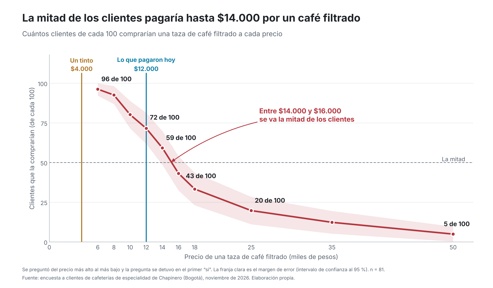

# **RESULTADOS**

**Universidad del Rosario · Haciendo Economía 2026-2**
**Profesor:** Paul Rodríguez L.
**Estudiantes:** Santiago Gómez, Camilo Ospina, Emily Rodríguez y David Pascagaza

---

Todas las figuras y tablas de esta carpeta las genera [`Scripts/02_visualizaciones.py`](../Scripts/02_visualizaciones.py) a partir de `Datos/limpios/base_analisis.csv` (81 encuestas válidas). Ninguna cifra se escribió a mano. Cada figura está en PNG (300 dpi, para presentaciones) y en PDF (vectorial, para el informe).

Por qué elegimos cada tipo de gráfica: [`Documentacion/Entrega 5 - Visualizaciones.pdf`](../Documentacion/Entrega%205%20-%20Visualizaciones.pdf).

## 📊 Figuras principales (`figuras/`)

Están pensadas para entenderse a primera vista, también por personas que no estudian economía. Cuentan la historia en seis pasos.

| # | Archivo | Pregunta | Hallazgo |
|---|---|---|---|
| 1 | `fig1_quienes_respondieron` | ¿Quiénes respondieron? | 80 % tiene menos de 35 años; 32 % visitaba la cafetería por primera vez |
| 2 | `fig2_hasta_cuanto_pagarian` | ¿Hasta cuánto pagarían por un filtrado? | La mitad pagaría hasta $14.000; entre $14.000 y $16.000 se va la mitad |
| 3 | `fig3_cuantos_tintos_vale` | ¿Cuántos tintos vale un filtrado? | Para 58 de cada 100, vale 4 tintos o más |
| 4 | `fig4_pagarian_lo_que_pagaron` | ¿Pagarían lo que pagaron hoy? | 70 de cada 100 pagarían por un filtrado al menos lo que pagaron |
| 5 | `fig5_quien_paga_mas` | ¿Quién paga más? | El estrato y el ingreso marcan la diferencia; el conocimiento, no de forma clara |
| 6 | `fig6_que_buscan` | ¿Qué buscan los que pagarían más? | Origen y sabor; quienes pagarían menos, ambiente y atención |

## 🔬 Anexo técnico (`figuras/anexo/`)

Lo que pide el plan de análisis del protocolo.

| Archivo | Contenido |
|---|---|
| `A1_curvas_por_grupo` | Curvas de aceptación por estrato, ingreso, educación, conocimiento y frecuencia, con la diferencia en $12.000 y la ji cuadrado; incluye la sensibilidad del conocimiento con las cuatro preguntas |
| `A2_distribucion_dap` | Distribución de la DAP por intervalo de la escalera, sin punto medio |

## 📋 Tablas de apoyo (`tablas/`)

| Archivo | Contenido |
|---|---|
| `curva_aceptacion.csv` | Porcentaje que acepta cada precio, con su IC 95 % |
| `distribucion_dap.csv` | Clientes por intervalo de DAP |
| `tintos_por_filtrado.csv` | Clientes según cuántos tintos vale el filtrado |
| `comparaciones_grupos.csv` | Porcentaje que acepta $12.000 por grupo, ji cuadrado, grados de libertad, p, niveles de DAP usados y aviso de casilla pequeña |
| `atributos_por_dap.csv` | Porcentaje que menciona cada atributo en 1.er o 2.º lugar, según la DAP quede por debajo, en o por encima de $12.000 |

## 🎨 Criterios de diseño

- Gris para el contexto y color solo para el mensaje: vino para el hallazgo, azul para el contraste y caramelo para el tinto. La paleta se validó para que se distinga con daltonismo.
- Títulos que dicen el hallazgo, subtítulos que dicen qué se mide y notas con el n y el detalle técnico.
- "De cada 100" en lugar de porcentajes, y la prima traducida a tintos.
- La DAP es un intervalo: nunca se usa el punto medio.
- El conocimiento se mide con D4 y D5, las únicas preguntas iguales para todos los encuestados (ver el [registro de versiones](../Documentacion/Registro%20de%20versiones%20del%20instrumento.md)).

`mapa_cafeterias.png`: mapa de las cafeterías visitadas (Entrega 4).
